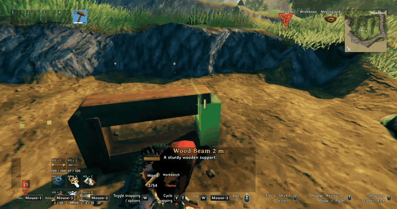
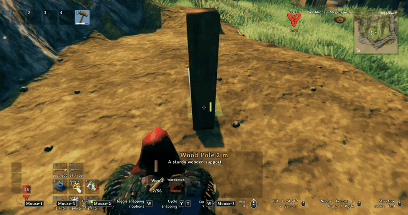

# Enigma's Snug Fit

*Place it a little closer to how you meant it.*

Spin, tilt and nudge a piece by small steps while you place it, snap its middle onto another piece, and sink a beam end into the ground without any creative-mode tools. It keeps the feel of vanilla placement: the scroll wheel still spins, snapping still snaps, and everything is a setting. Client side, other players do not need it to see what you build.

## What it looks like

### Spin and tilt

Scroll spins the piece in steps, hold Shift and scroll tilts it. The piece keeps snapping to what it is pointed at.

## Features

- Spin step you can change. The scroll wheel works as in vanilla, 22.5 degrees per click by default.
- Tilt: Shift + scroll tilts a building piece or an item stand around its own X axis, 22.5 degrees per click by default. Chests, furniture, armor stands and crafting stations only spin, as they do in vanilla. You can add more pieces in the settings.
- Nudge in three directions, with the wheel and a held key: Ctrl + scroll up and down (world up, so a tilted piece still sinks straight down), hold Z and scroll left and right, hold X and scroll forward and back. 2 cm per click, up to 14 cm each way by default.
- Snap center: Tab cycles a piece's snap points as in vanilla. For building pieces the cycle now ends with a Center point, which snaps the middle of your piece onto another piece's snap points and middles. Automatic snapping stays exactly as in vanilla.
- Backspace clears the tilt and the nudge. Copy rotation also copies the tilt of the piece you copy.
- Tilt and Nudge lines in the build key hints, so you do not have to remember the keys.
- Controller support is built in (see Known issues).

## How it works

Pick a piece with the hammer and use the keys above. The changes are applied to the placement ghost before the game checks snapping and placing, so a tilted or nudged piece still snaps to joints and gets the usual placement checks. The nudge is added on top of the snapped position, so you can snap a beam end onto a crossing and then sink it a few centimeters.

Snug Fit does not need or use Gizmo. If another mod rewrites the game's placement rotation code (Gizmo and similar), Snug Fit switches spin step and tilt off so the two do not fight, keeps nudge working, and writes the reason to the log.

## Download

Install from Thunderstore with r2modman or the Thunderstore app. Dependencies are installed automatically:

[https://thunderstore.io/c/valheim/p/Enigma_Prime/Enigmas_Snug_Fit/](https://thunderstore.io/c/valheim/p/Enigma_Prime/Enigmas_Snug_Fit/)

To change settings in game, install Configuration Manager and press F1.

## Settings

Settings are in `BepInEx/config/EnigmaPrime.EnigmasSnugFit.cfg` after the first run:

- 1 - Rotation: spin step, tilt on or off, tilt step and key, which pieces can tilt, whether tilt clears when the piece changes, copy tilt.
- 2 - Nudge: nudge on or off, step size, the three keys, the three limits, whether the nudge clears after placing.
- 3 - Other: reset key, key hints on or off, the switch that turns rotation features off when another mod changes rotation.
- 5 - Snap center: on or off, which piece categories get a Center point, extra pieces by name.

## Multiplayer and servers

Client side only. A dedicated server does not need it. Multiplayer has not been tested yet.

## Compatibility

- Gizmo and other mods that rewrite the placement rotation code: spin step and tilt switch off, nudge keeps working. Using only one of them is simplest.
- Snug Fit patches the placement ghost conservatively and does not replace vanilla code where it can avoid it.

## Known issues

- Controller support is built in (hold the alt button and rotate to tilt, hold it and use the right stick to nudge) but untested, please report problems. Forward and back nudge has no controller button yet.
- Multiplayer is untested.
- A nudged position is not checked against other pieces again, which is fine for a few centimeters.

## Support

If you like the mod and want to say thanks, you can: [buy me a coffee on Ko-fi](https://ko-fi.com/enigmaprime)

 

Bug reports and ideas are just as welcome. Open an issue on [GitHub](https://github.com/relinkem/Enigmas-Snug-Fit/issues) and include your BepInEx log (`LogOutput.log`) and, if it is a settings problem, your config file. Ideas and suggestions are also welcome in the comments on my [Ko-fi page](https://ko-fi.com/enigmaprime).

## More mods by Enigma Prime

**[Enigma's Realistic Smoke Rework](https://thunderstore.io/c/valheim/p/Enigma_Prime/Enigmas_Realistic_Smoke_Rework/)** Smoke that rises, pools and bends in the wind, with flames that follow their fuel.

 

**[Enigma's Item Salvager](https://thunderstore.io/c/valheim/p/Enigma_Prime/Enigmas_Item_Salvager/)** Take your gear apart at the Workbench, Forge, Black Forge or Galdr Table and get some of the materials back.

 

**[Enigma's Useful Tasty Mead](https://thunderstore.io/c/valheim/p/Enigma_Prime/Enigmas_Useful_Tasty_Mead/)** A sweet mead that makes your food count as freshly eaten again, lifting your max health, stamina and Eitr before fading back.

 

**[Enigma's Enhanced Forging](https://thunderstore.io/c/valheim/p/Enigma_Prime/Enigmas_Enhanced_Forging/)** Smelters, kilns and the Eitr refinery become walk-away machines with inventory screens, a Light button and winding animations.

 

**[Enigma's Tidy Cart](https://thunderstore.io/c/valheim/p/Enigma_Prime/Enigmas_Tidy_Cart/)** Back your empty cart up to a wall and stow it upright out of the way, with your character playing it out.

 

## How this mod was made

The ideas, the design, and every decision about how placing a piece should work are mine: keep it as close to vanilla as possible, tilt only the pieces where it looks right, keep the nudge small and limited, let Tab offer a center snap only for building pieces. However, I am not a programmer. The code was written by Claude, an AI assistant made by Anthropic, working from my direction through [Claude Code](https://claude.com/claude-code).

I want to be upfront about that. I am the one who plays the game, so I test every build in Valheim, read the game log for errors, and send back anything that looks or feels wrong until it behaves the way I intended. The code was also checked against Valheim's own code so it hooks in the right places. If you find a bug, please open an issue and I will work on a fix.

Not affiliated with or endorsed by Anthropic.

## Changelog

See [CHANGELOG.md](https://github.com/relinkem/Enigmas-Snug-Fit/blob/main/Release/CHANGELOG.md).

## License

All rights reserved. You are free to download and use the mod, but please don't redistribute, modify or re-upload it without asking first, see [LICENSE](https://github.com/relinkem/Enigmas-Snug-Fit/blob/main/Release/LICENSE). Valheim is the property of Iron Gate AB and Coffee Stain Publishing. This mod is not affiliated with or endorsed by them.
